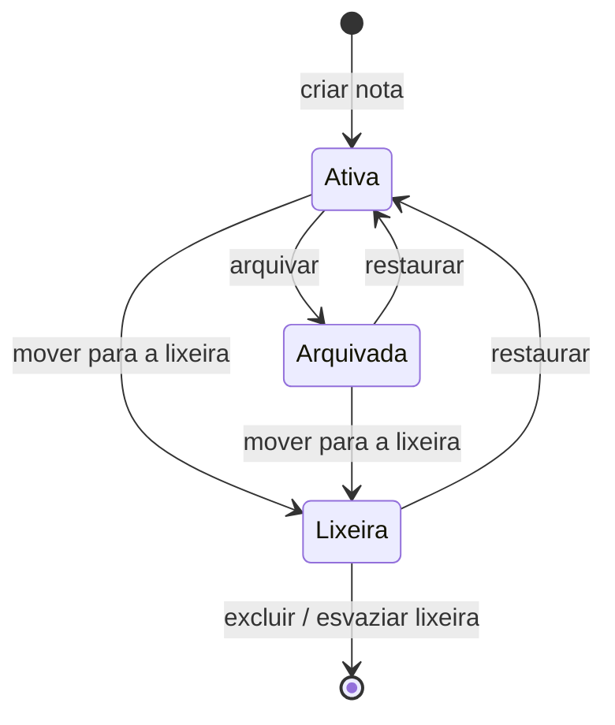
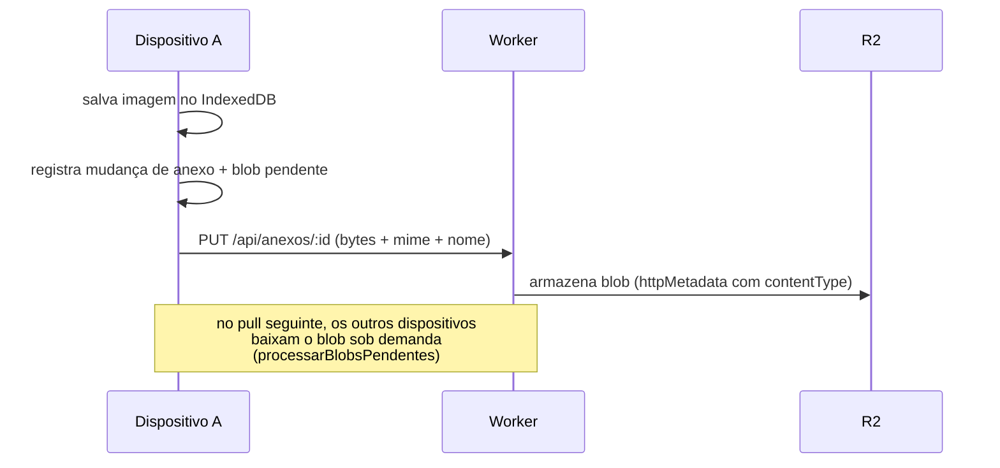

# ThothNet

Aplicação PWA de anotações e gestão visual do conhecimento. Funciona offline,
é privada por padrão (nada vai para a nuvem sem você sincronizar) e conecta as
notas entre dispositivos e por meio de um grafo de conhecimento.

## Funcionalidades

- **Notas** em três formatos: texto simples, Markdown e HTML, com favoritas,
  fixadas e duplicação.
- **Cadernos e tags** para organização; busca por termo com normalização de
  acentuação (busca por `organizacao` encontra *organização*).
- **Anexos** locais (imagens e arquivos) armazenados no IndexedDB e exibidos
  como blobs no editor.
- **Markdown enriquecido**: wikilinks `[[Título]]`, blocos **Mermaid** e
  tabelas/GFM.
- **Grafo de conhecimento**: nós = notas; arestas por wikilinks `[[Título]]`,
  tags compartilhadas e palavras-chave em comum, com filtro por tipo e
  alternância de layout (automático ou círculos concêntricos); visão
  global (`/grafo`) e contextual (`/grafo/:id`) com backlinks.
- **Nuvem de palavras** (`/nuvem`): os termos mais recorrentes das notas em uma
  nuvem colorida — clique em uma palavra para buscar as notas relacionadas.
- **Sincronização** entre dispositivos via Cloudflare Worker (D1 + R2),
  offline-first com conflitos resolvidos por revisão vencedora (LWW).
- **Importação e exportação**: Markdown, HTML e JSON.
- **PWA**: instalável, com service worker (precache) e suporte a modo escuro.

## Arquitetura

App React (Vite + TypeScript) em camadas, com persistência local em IndexedDB:

```mermaid
flowchart LR
    UI[Camada de interface<br/>features + layout] --> CORE[Núcleo<br/>repositorios, markdown, erros]
    UI --> SYNC[Sync<br/>transporte e aplicação]
    CORE --> DOMINIO[Domínio<br/>tipos e entidades]
    CORE --> IDB[(IndexedDB<br/>notas, cadernos, tags,<br/>anexos, meta)]
    SYNC ===> WORKER[Worker Cloudflare<br/>thoth-sync]
    SUBGRAPH WORKER
      WORKER --> D1[(D1<br/>revisão por LWW)]
      WORKER --> R2[(R2<br/>blobs de anexos)]
    END
    IDB -.-> SW[Service worker<br/>vite-plugin-pwa · precache]
```

- **`domain`** — entidades (`Nota`, `Caderno`, `Tag`, `Anexo`) e constantes
  (`StatusNota`, `FormatoNota`).
- **`core`** — acesso à camada de dados (IndexedDB), renderização de Markdown,
  extração de wikilinks/grafo e tratamento de erros.
- **`sync`** — fila de mudanças, revisões e transporte para o servidor.
- **`features`** — telas (notas, cadernos, tags, busca, anexos, grafo, status,
  importar/exportar, sincronização).
- **`app`** — rotas com *code splitting* (todas as páginas são carregadas sob
  demanda; Mermaid e Cytoscape entram apenas quando usados).

## Fluxos

### Ciclo de vida de uma nota



Cada criação, edição ou remoção de nota gera um **registro de mudança** (com
revisão) que fica pendente na fila até a próxima sincronização.

### Relacionamentos entre notas

```mermaid
flowchart LR
    NOTA_A[Nota A<br/>conteúdo com [[Título B]] + tags] -->|extração de wikilinks, tags e termos| LINKS[GrafoDeNotas<br/>relações por tipo<br/>wikilink / tag / termo]
    NOTA_B[Nota existente com título "Título B"] --> LINKS
    TAGS[(Tags compartilhadas)] --> LINKS
    TERMOS[(Palavras-chave em comum<br/>título e conteúdo)] --> LINKS
    LINKS --> GLOBAL[Visão global<br/>/grafo]
    LINKS --> CONTEXTUAL[Visão contextual<br/>/grafo/:id]
    LINKS --> NUVEM[Nuvem de palavras<br/>/nuvem]
    LINKS --> BACK[Backlinks<br/>quem aponta para mim]
    LINKS --> PREVIEW[MarkdownPreview<br/>[[Título]] vira link clicável]
```

- A sintaxe `[[Título]]` dentro do conteúdo cria um link para a nota com aquele
  título (comparação normalizada, sem acentos e caixa-insensível).
- Arestas de **tag** conectam notas que compartilham tags; arestas de **termo**
  conectam notas com palavras-chave em comum no título e conteúdo (stopwords e
  termos frequentes demais são ignorados). No grafo global é possível filtrar
  cada tipo de aresta.
- O grafo traz alternância de **layout**: *Automático* (força direcionada, notas
  relacionadas ficam próximas — padrão) ou *Círculos* (anéis concêntricos, os
  nós mais conectados no centro).
- Blocos ```mermaid no conteúdo também renderizam diagramas no preview,
  acompanhando o tema claro/escuro.

### Sincronização entre dispositivos

Dispositivo **A** cria/edita notas e anexos offline; na sincronização, envia as
mudanças pendentes e busca as do servidor. O servidor **não** impõe quem ganha:
mantém o registro de revisão mais recente (revisão = carimbo + dispositivo).

```mermaid
sequenceDiagram
    participant A as Dispositivo A
    participant B as Dispositivo B
    participant W as Worker (Bearer segredo)
    participant D1 as D1 (registros)
    participant R2 as R2 (anexos)

    A->>A: edita notas offline (fila de pendentes)
    A->>W: POST /api/sync/push (mudanças + revisões)
    W->>D1: upsert se revisão for a mais nova
    A->>W: POST /api/sync/pull (desde cursor)
    W-->>A: mudanças mais recentes que o cursor
    A->>W: GET /api/anexos/:id (blobs pendentes)
    W->>R2: retorna blob
    A->>A: aplica localmente e avança o cursor

    B->>W: POST /api/sync/pull (sem cursor)
    W-->>B: tudo que existe (lote)
    B->>W: GET /api/anexos/:id
    W-->>B: blobs
    B->>B: aplica; uso compartilhado entre dispositivos
```

Quando `A` envia um anexo novo, o fluxo é:



## Estrutura

```
ThothNet/
├── src/
│   ├── app/          # rotas (lazy) e shell da aplicação
│   ├── components/   # UI reutilizável (botão, badge, modal, empty state)
│   ├── core/         # storage (IndexedDB), markdown, erros, grafo
│   ├── domain/       # entidades e constantes
│   ├── features/     # telas por área (notas, grafo, sync, …)
│   ├── layout/       # shell, sidebar e navegação mobile
│   ├── sync/         # transporte, revisões, blobs e aplicação local
│   └── theme/        # tema claro/escuro
├── cloud/workers/
│   └── thoth-sync/   # Worker de sincronização (D1 + R2)
│       ├── migrations/0001_registros.sql
│       └── wrangler.jsonc
└── scripts/          # harness de testes (e2e e grafo)
```

## Desenvolvimento

```bash
pnpm install          # na raiz do workspace (ThothNet)
npm run dev           # Vite com HMR
npm run build         # tsc -b && vite build (gera PWA)
npm run preview       # servidor estático do build
npm run lint          # oxlint (0 warnings/erros)
```

### Testes

| Comando          | O que valida                                                               |
| ---------------- | -------------------------------------------------------------------------- |
| `npm run teste:grafo` | wikilinks, tags e termos (filtro por tipo), resolução de títulos, vizinhança, backlinks e plugin remark (25 passos) |
| `npm run teste:e2e`   | sincronização ponta a ponta entre dois dispositivos falsos + Worker local (`wrangler dev --local`), 9 passos |

## Sincronização (backend)

O Worker `thoth-sync` expõe uma API autenticada por **segredo compartilhado**
(`Authorization: Bearer <SEGREDO>`):

| Método | Rota            | Descrição                            |
| ------ | --------------- | ------------------------------------ |
| POST   | `/api/sync/push`| Recebe mudanças e aplica revisões LWW |
| POST   | `/api/sync/pull`| Devolve mudanças a partir de um cursor |
| PUT    | `/api/anexos/:id` | Sobe o blob de um anexo para R2     |
| GET    | `/api/anexos/:id` | Baixa o blob                          |
| DELETE | `/api/anexos/:id` | Remove o blob (usado no tombstone)   |

### Deploy

1. Crie o banco D1 e o bucket R2 e preencha `database_id` em
   `wrangler.jsonc` (hoje está como placeholder).
2. Defina a variável `SEGREDO` (ver segredos do Worker).
3. Publique com `wrangler deploy` em `cloud/workers/thoth-sync`.
4. No app, configure a URL do Worker e o segredo em **Sincronização**
   (`/sincronizar`).

No desenvolvimento local, o `garantirSchema()` do Worker aplica o schema
idempotentemente — as migrations em `migrations/` servem para o ambiente
produzido.

## Roadmap

- Etapa 1.3 (concluída): anotações, organização, anexos e PWA.
- Sincronização entre dispositivos (concluída): offline-first, com fila de
  mudanças, revisões LWW e anexos sob demanda.
- Etapa 1.4 (concluída): knowledge graph (wikilinks + tags + palavras-chave,
  grafo global e contextual, backlinks, nuvem de palavras) e diagramas Mermaid
  em Markdown.

## Privacidade

Tudo é **offline first**: notas, cadernos, tags e anexos vivem no IndexedDB do
dispositivo. Os dados só trafegam quando a sincronização é configurada e
disparada manualmente, e a autenticação usa um segredo compartilhado.