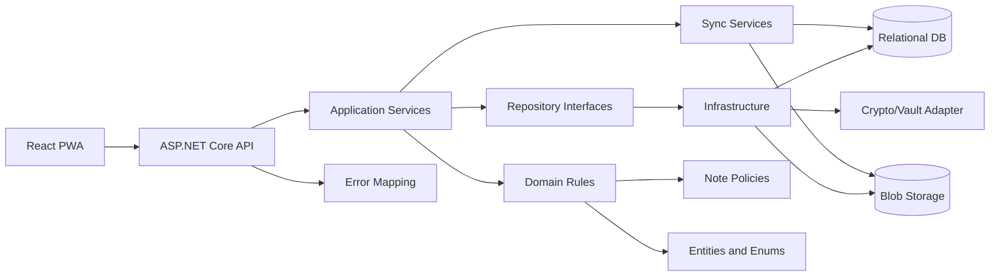
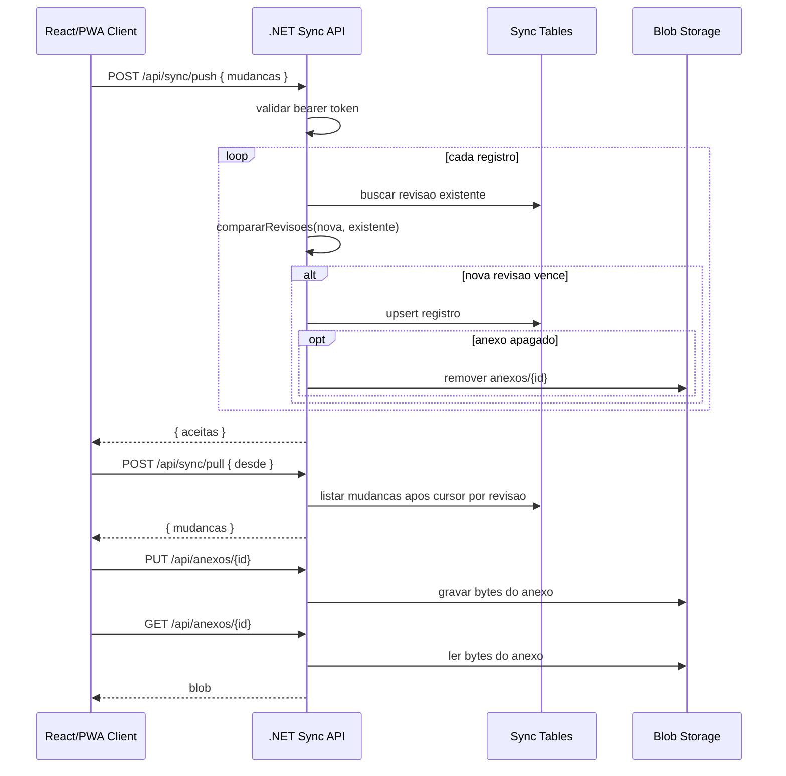

# Backend .NET Migration Roadmap

> **For agentic workers:** REQUIRED SUB-SKILL: Use superpowers:subagent-driven-development (recommended) or superpowers:executing-plans to implement this plan task-by-task. Steps use checkbox (`- [ ]`) syntax for tracking.

**Goal:** Migrar a logica de negocio, validacoes, estrutura de dados, autorizacao, persistencia e sincronizacao do ThothNet para um backend .NET sem alterar o comportamento funcional observado no frontend React.

**Architecture:** O backend deve assumir autoridade sobre dominio, aplicacao, persistencia e autorizacao. O React deve permanecer como cliente, consumindo APIs e mantendo somente estado de UI, renderizacao, PWA e adaptadores locais estritamente necessarios.

**Tech Stack:** .NET 8/9, ASP.NET Core Web API, Entity Framework Core, banco relacional, armazenamento de blobs, testes xUnit/NUnit, contratos JSON compativeis com os tipos TypeScript atuais.

---

## Premissas

- O backend .NET sera a fonte de verdade para regras, permissoes e persistencia.
- Os nomes string dos enums atuais devem ser preservados para compatibilidade: `ATIVA`, `ARQUIVADA`, `LIXEIRA`, `MARKDOWN`, `TXT`, `HTML`, `USUARIO`, `ADMIN`, `PRIVADA`, `PUBLICA`, `PENDENTE`, `ACEITA`, `REJEITADA`, `CONFLITO`, `GRUPO`.
- Datas devem continuar em ISO 8601 UTC equivalente a `new Date().toISOString()`.
- IDs atuais gerados por `gerarId()` devem continuar aceitos; a estrategia de novos IDs no backend deve ser decidida antes de implementar gravacao.
- Os testes existentes em `scripts/teste-*.ts` devem virar uma suite de paridade no backend.
- Codigo React, layout, tema, componentes visuais e hooks de tela nao devem ser migrados como regra de negocio.

## Arquivos e Metodos a Migrar

### Entidades e Contratos

| Arquivo | Migrar |
| --- | --- |
| `src/domain/tipos.ts` | `STATUS_NOTA`, `FORMATO_NOTA`, `PAPEL_USUARIO`, `VISIBILIDADE_NOTA`, `STATUS_SUGESTAO_NOTA`, `TIPO_ALVO_PERMISSAO`, tipos derivados e labels quando usados em respostas. |
| `src/domain/nota.ts` | `Nota`, `NovaNota`, `AlteracaoNota`, `tituloDaNota`. |
| `src/domain/caderno.ts` | `Caderno`, `NovoCaderno`. |
| `src/domain/tag.ts` | `Tag`, `NovaTag`. |
| `src/domain/anexo.ts` | `Anexo`, `NovoAnexo`, `PREFIXO_ANEXO`, `urlDeAnexo`, `idDeUrlDeAnexo`. |
| `src/domain/usuario.ts` | `Usuario`, `NovoUsuario`, `USUARIO_PADRAO_ID`, `NOME_USUARIO_PADRAO`. |
| `src/domain/grupo.ts` | `Grupo`, `MembroGrupo`, `NovoGrupo`. |
| `src/domain/permissao-nota.ts` | `PermissaoNota`, `NovaPermissaoNota`. |
| `src/domain/sugestao-nota.ts` | `SugestaoNota`, `NovaSugestaoNota`. |
| `src/domain/auth.ts` | `ContaLocal`, `SessaoPublica`, se o backend assumir autenticacao/cofre. |
| `src/domain/id.ts` | `gerarId`, ou decisao explicita de substituicao mantendo compatibilidade de IDs existentes. |
| `src/domain/duplicacao-nota.ts` | `SUFIXO_TITULO_COPIA`, `DadosDuplicacaoNota`, `duplicarNotaParaUsuario`. |

### Politicas de Nota e Autorizacao

| Arquivo | Migrar |
| --- | --- |
| `src/domain/politicas-nota.ts` | `ehDono`, `ehAdmin`, `ehUsuarioPadrao`, `notaEhPublica`, `possuiPermissaoNaNota`, `possuiPermissaoDeSugerir`, `podeVisualizar`, `podeEditarDireto`, `podeExcluir`, `podeMoverLixeira`, `podeDuplicar`, `podeSugerir`, `podeTransferir`. |
| `src/core/autorizacao/notas.ts` | `ContextoOperacaoNota`, `ContextoAutorizacaoNota`, `erroAcessoNegado`, `resolverUsuarioDaOperacao`, `resolverContextoAutorizacaoNota`. |
| `src/core/repositorios/notas-protegidas.ts` | `obterComoUsuario`, `atualizarComoUsuario`, `mudarStatusComoUsuario`, `removerComoUsuario`, `duplicarComoUsuario`, `transferirComoUsuario`, `criarSugestaoComoUsuario`, `revisarSugestaoComoUsuario`. |

### Governanca

| Arquivo | Migrar |
| --- | --- |
| `src/core/governanca.ts` | `ResumoGovernanca`, `NovoUsuarioGovernanca`, `NovoGrupoGovernanca`, `garantirPrimeiroAdministrador`, `governancaStore.podeAcessar`, `listar`, `criarUsuario`, `atualizarUsuario`, `criarGrupo`, `renomearGrupo`, `removerGrupo`, `adicionarMembro`, `removerMembro`. |

### Repositorios e Persistencia de Dominio

| Arquivo | Migrar |
| --- | --- |
| `src/core/repositorios/notas.ts` | `AFiltroNota`, `NovaNota`, `ContextoNotaUsuario`, `buscarPorTermo`, `notasStore.criar`, `atualizar`, `obter`, `listarTodas`, `listar`, `remover`, `limparLixeira`, `mudarStatus`, `alternarFavorita`, `alternarFixada`, `duplicar`, `contagemPorStatus`, `contagemPorCaderno`, `contagemPorTag`, `removerTagDeTodasNotas`. |
| `src/core/repositorios/cadernos.ts` | `cadernosStore.criar`, `obter`, `listarTodas`, `listar`, `renomear`, `remover`. |
| `src/core/repositorios/tags.ts` | `tagsStore.criar`, `obter`, `listarTodas`, `listar`, `renomear`, `remover`. |
| `src/core/repositorios/anexos.ts` | `NovoAnexo`, `construirAnexo`, `anexosStore.criar`, `obter`, `listarPorNota`, `listarTodas`, `remover`, `removerPorNota`. Nao migrar `baixarAnexo` e `urlDeBlobAnexo`, pois sao browser-only. |
| `src/core/repositorios/usuarios.ts` | `NovoUsuarioRepositorio`, `usuariosStore.criar`, `garantir`, `obter`, `listarTodas`, `listar`, `atualizar`, `remover`. |
| `src/core/repositorios/grupos.ts` | `NovoGrupoRepositorio`, `gruposStore.criar`, `obter`, `listarTodas`, `listar`, `renomear`, `remover`. |
| `src/core/repositorios/membros-grupos.ts` | `NovoMembroGrupoRepositorio`, `membrosGruposStore.adicionar`, `obter`, `listarTodas`, `listarPorGrupo`, `listarPorUsuario`, `remover`. |
| `src/core/repositorios/permissoes-nota.ts` | `NovaPermissaoNotaRepositorio`, `permissoesNotaStore.criar`, `conceder`, `obter`, `listarTodas`, `listarPorNota`, `remover`, `removerPorNotaAlvo`. |
| `src/core/repositorios/sugestoes-nota.ts` | `NovaSugestaoNotaRepositorio`, `sugestoesNotaStore.criar`, `obter`, `listarTodas`, `listarPorNota`, `revisar`. |

### Storage, Cofre e Criptografia

| Arquivo | Migrar ou adaptar |
| --- | --- |
| `src/core/storage/config.ts` | `BANCO.nome`, `BANCO.versao`, nomes das stores como nomes logicos de tabelas/colecoes. |
| `src/core/storage/idb.ts` | Sem migrar IndexedDB literalmente. Migrar a semantica de schema, indices, transacoes, `MIGRACAO_MULTIUSUARIO`, `notaPrecisaMigrar`, `migrarMultiusuarioNoBanco`, `lerItem`, `gravarItem`, `gravarItensEmTransacao`, `listarItens`, `listarEntradas`, `apagarItem`, `lerMeta`, `gravarMeta`. |
| `src/core/auth/crypto.ts` | `gerarSalt`, PBKDF2 SHA-256, AES-GCM key derivation, `verificadorDeMaterial`, `derivarChaveEVerificador`, `digerirTexto`, `validarSenha`, `compararSegredos`. |
| `src/core/auth/contas.ts` | `normalizarNomeConta`, `listarContas`, `obterContaPorNome`, `criarConta`, `apagarConta`, se o backend substituir contas locais. |
| `src/core/auth/sessao.ts` | Migrar como servico de sessao/autenticacao se o backend assumir login: `desbloquear`, `criarContaLocal`, `bloquear`, `removerContaAtual`, `removerConta`. Eventos de UI nao migram. |
| `src/core/auth/legado.ts` | `haDadosNoBancoAtual`, `migrarDadosLegados`, `ResultadoMigracao`, se houver importacao de bancos locais legados. |
| `src/core/vault/cifrar.ts` | `EnvelopeCifrado`, `ehEnvelope`, `bytesParaBase64`, `base64ParaBytes`, `cifrarBytes`, `decifrarBytes`, `cifrarRegistro`, `decifrarRegistro`. |
| `src/core/vault/serial.ts` | `valorPersistivel`, `valorDoPersistivel` e conversao de blobs/base64. |

### Importacao, Exportacao e Intercambio

| Arquivo | Migrar |
| --- | --- |
| `src/core/dados/json.ts` | `ESCOPOS_EXPORTACAO_JSON`, `montarJson`, `parseJsonIntercambio`, `importarDadosJson`, validadores de formato/status e ordenacao de cadernos. |
| `src/core/dados/intercambio.ts` | `montarTextoDeNotas`, `dividirNotasDoArquivo`, `tituloDoArquivo`, conversores Markdown/TXT/HTML. |
| `src/core/dados/backup-fiel.ts` | `NOME_MANIFESTO_BACKUP_FIEL`, `PREFIXO_ARQUIVO_ANEXO_FIEL`, interfaces de manifesto, validadores de manifesto, `exportarBackupFiel`, `importarBackupFiel`. |
| `src/core/dados/backup-fiel-pasta.ts` | Nao migrar File System Access API; manter apenas contrato de pacote se o backend oferecer download ZIP/pasta. |
| `src/features/dados/operacoes.ts` | Migrar apenas regras de orquestracao sem browser: `importarArquivos`, `exportarBackupFielAplicacao`, `exportarNotasAplicacao`. Nao migrar `baixarArquivo`. |

### Sincronizacao

| Arquivo | Migrar |
| --- | --- |
| `src/sync/contrato.ts` | `TIPOS_REGISTRO`, `Revisao`, `RegistroSync`, `novaRevisao`, `compararRevisoes`, `revisaoParaChave`, `revisaoDeChave`, `CHAVES_SINCRONIZACAO`, `TAMANHO_LOTE`. |
| `src/sync/registros.ts` | `DadosSyncNota`, `DadosSyncCaderno`, `DadosSyncTag`, `DadosSyncAnexo`, `dadosDeNota`, `dadosDeCaderno`, `dadosDeTag`, `dadosDeAnexo`, `registroSincronizavel`. |
| `src/sync/mudancas.ts` | `registrarNota`, `registrarCaderno`, `registrarTag`, `registrarAnexo`, `registrarRemocao`, `marcarSincronizado`, `removerPendente`, `lerRevisaoLocal`; `registrarMudanca` como servico interno. |
| `src/sync/aplicar.ts` | `aplicarRegistros`, incluindo resolucao de conflitos por `compararRevisoes`, remocao de anexos quando nota e apagada e pendencia de blobs. |
| `src/sync/armazenamento.ts` | `lerSincronizacao`, `gravarSincronizacao`, `apagarSincronizacao`, `listarPorPrefixo`, `contarPorPrefixo` como persistencia de sync. |
| `src/sync/blobs.ts` | `processarBlobsPendentes`, `recuperarBytesBaixados`, persistencia de metadados e bytes de anexo. |
| `src/sync/config.ts` | `ConfiguracaoSync`, `validarConfiguracao`, `limparUrlSync`, `lerConfiguracaoSync`, `salvarConfiguracaoSync`, `removerConfiguracaoSync`, `erroSincronizacao`. |
| `src/sync/dispositivo.ts` | `obterDispositivo`, se sync cliente-servidor continuar usando dispositivo local. |
| `src/sync/endpoints.ts` | Migrar como contratos HTTP; no backend implementar rotas equivalentes a push, pull e blobs. |
| `src/sync/transportar.ts` | `sincronizar`, `obterEstadoSincronizacao`, `enviarPendentes`, `baixarRemoto`, `lerCursor`, se houver modo hibrido offline-first. |
| `cloud/workers/thoth-sync/src/contrato.ts` | `TIPOS_REGISTRO`, `RegistroSync`, `Revisao`, `compararRevisoes`, `TAMANHO_LOTE`. |
| `cloud/workers/thoth-sync/src/index.ts` | Substituir por controllers/services .NET: `autorizado`, `linhaParaRegistro`, `gravarRegistro`, `garantirSchema`, `tratarPush`, `tratarPull`, `tratarBlob`, `fetch` routing. |

### Grafo, Busca Semantica e Nuvem

| Arquivo | Migrar se backend fornecer resultados derivados |
| --- | --- |
| `src/core/grafo/grafo.ts` | `TipoRelacao`, `Relacao`, `GrafoDeNotas`, `normalizarTitulo`, `extrairLinksDoTexto`, `construirGrafoDeNotas`, `vizinhancaDe`, `backlinksDe`. |
| `src/core/grafo/termos.ts` | `TAMANHO_MINIMO_TERMO`, `FRACAO_MAXIMA_TERMO`, `FrequenciaDeTermo`, `obterTokens`, `listarFrequenciasDeTermos`. |
| `src/core/grafo/stopwords.ts` | Lista `STOPWORDS`, se nuvem/grafo por termo rodar no backend. |
| `src/core/grafo/constantes.ts` | Padrao de wikilink usado por `extrairLinksDoTexto`. |
| `src/core/nuvem/config.ts` | `NUVEM`, `ConfiguracaoNuvem`, `normalizarTop`, `normalizarStopword`, `lerConfiguracaoNuvem`, `salvarConfiguracaoNuvem`. |

### Erros e Formatacao

| Arquivo | Migrar ou adaptar |
| --- | --- |
| `src/core/errors/AppError.ts` | `AppError` como excecao de dominio/aplicacao no backend. |
| `src/core/errors/errorCodes.ts` | `ERROR_CODES` como codigos estaveis de resposta. |
| `src/core/errors/format.ts` | Adaptar `formatarErro` e `getMensagemUsuario` para camada de API/cliente. |
| `src/core/formato/datas.ts` | Migrar apenas se respostas backend precisarem de strings formatadas; preferir data bruta e formatacao no cliente. |
| `src/core/formato/arquivos.ts` | Migrar apenas se API retornar texto de tamanho/estimativa; preferir valores brutos no backend. |

## Arquivos que Nao Devem Ir para o Backend

- `src/app/**`: roteamento e bootstrap React.
- `src/layout/**`: shell visual, sidebar, header e navegacao.
- `src/components/**`: componentes UI.
- `src/features/**/*Page.tsx`: telas e handlers de UI.
- `src/features/**/hooks/**`: hooks de carregamento e estado.
- `src/core/markdown/render.tsx`, `src/core/markdown/DiagramaMermaid.tsx`: renderizacao React/browser.
- `src/core/grafo/useMapaDeLinks.ts`: hook React.
- `src/theme/**`, `src/main.tsx`, `src/pwa.ts`, `src/index.css`.
- `src/core/repositorios/anexos.ts`: `baixarAnexo` e `urlDeBlobAnexo`.

## ADRs em Sequencia Logica

### ADR-0001 - Definir Backend .NET como Autoridade de Dominio

**Status:** Proposto.

**Contexto:** Hoje o dominio, as politicas e a persistencia vivem no cliente IndexedDB.

**Decisao:** Centralizar regras de negocio, autorizacao e persistencia em ASP.NET Core, mantendo o frontend como consumidor.

**Consequencias:** O React deixa de aplicar regras criticas diretamente. Todas as rotas de escrita precisam validar usuario, permissao, integridade referencial e transicoes de estado.

### ADR-0002 - Preservar Contratos JSON e Valores de Enum

**Status:** Proposto.

**Contexto:** Sync, backup, importacao e UI dependem de strings exatas.

**Decisao:** DTOs .NET devem usar os mesmos nomes de campos e valores string atuais.

**Consequencias:** Evita quebra em backup/sync. Mapeamentos internos podem usar enums C#, mas serializacao deve ser string compativel.

### ADR-0003 - Organizar o Backend por Clean Architecture

**Status:** Proposto.

**Contexto:** O repositorio ja separa `domain`, `core`, `sync` e `features`.

**Decisao:** Criar camadas:

- `Domain`: entidades, value objects, enums, politicas puras.
- `Application`: casos de uso, autorizacao, governanca, sync, import/export.
- `Infrastructure`: EF Core, blob storage, criptografia, clock, gerador de IDs.
- `Api`: controllers/endpoints, filtros de erro, autenticacao.

**Consequencias:** Mantem regras testaveis sem HTTP/EF e reduz risco de misturar UI com regra.

### ADR-0004 - Manter Paridade de IDs, Datas e Ordenacao

**Status:** Proposto.

**Contexto:** O cliente usa `gerarId()`, `toISOString()` e ordenacoes `localeCompare('pt-BR')`.

**Decisao:** Definir contratos explicitos para ID, timestamps UTC e ordenacao. Onde a ordenacao `pt-BR` for observavel, cobrir com testes de paridade.

**Consequencias:** Evita alteracao sutil de listagem, duplicacao e sync.

### ADR-0005 - Migrar IndexedDB para Modelo Relacional sem Mudar Semantica

**Status:** Proposto.

**Contexto:** As stores atuais viram entidades persistidas.

**Decisao:** Mapear `notas`, `cadernos`, `tags`, `anexos`, `usuarios`, `grupos`, `membrosGrupos`, `permissoesNota`, `sugestoesNota`, `meta` e `sincronizacao` para tabelas ou agregados equivalentes.

**Consequencias:** Integridade referencial pode ser reforcada, mas nao deve bloquear dados que o importador/backup atual aceita.

### ADR-0006 - Isolar Politicas de Autorizacao de Controllers

**Status:** Proposto.

**Contexto:** `notas-protegidas.ts` combina autorizacao com repositorios.

**Decisao:** Criar services de aplicacao para notas protegidas e governanca; controllers apenas traduzem HTTP.

**Consequencias:** Facilita testes equivalentes aos scripts de multiusuario, operacoes de nota e governanca.

### ADR-0007 - Definir Estrategia de Criptografia e Cofre

**Status:** Proposto.

**Contexto:** O app cifra registros localmente com PBKDF2, AES-GCM e envelope serializado.

**Decisao:** Antes de migrar dados cifrados, decidir entre manter criptografia ponta-a-ponta compativel ou mover criptografia para servidor.

**Consequencias:** Esta decisao precede persistencia final, sync e migracao de contas. Sem ela, dados existentes podem ficar ilegiveis.

### ADR-0008 - Substituir Cloudflare Worker por API .NET de Sync

**Status:** Proposto.

**Contexto:** O worker atual usa D1/R2 e rotas `/api/sync/push`, `/api/sync/pull`, `/api/anexos/{id}`.

**Decisao:** Implementar endpoints .NET equivalentes, mantendo comparacao de revisoes e lote de 200.

**Consequencias:** Clientes existentes podem migrar endpoint sem reescrever algoritmo de sync.

### ADR-0009 - Separar Blob Storage de Metadados de Anexo

**Status:** Proposto.

**Contexto:** `Anexo` mistura metadados e `Blob`; sync envia metadados em registro e bytes por endpoint separado.

**Decisao:** Persistir metadados em tabela e conteudo em storage de objeto/arquivo, com chave `anexos/{id}` ou equivalente.

**Consequencias:** Mantem compatibilidade com sync e evita gravar binarios grandes junto da entidade relacional.

### ADR-0010 - Migrar Importacao, Exportacao, Grafo e Nuvem como Servicos de Aplicacao

**Status:** Proposto.

**Contexto:** Essas funcoes nao sao persistencia direta, mas produzem resultados observaveis.

**Decisao:** Portar como services opcionais quando o backend precisar gerar backup, busca, grafo ou nuvem de palavras.

**Consequencias:** O frontend pode ficar mais leve, mas endpoints devem ser cobertos por testes de paridade.

## Fluxo Arquitetural Mermaid

## Fluxo de Sync Mermaid

## Roadmap de Implementacao

### Fase 1 - Contratos e Testes de Paridade

- [ ] Criar projeto .NET com camadas `Domain`, `Application`, `Infrastructure`, `Api` e `Tests`.
- [ ] Portar enums e DTOs de `src/domain/*`.
- [ ] Criar testes de serializacao garantindo que os nomes JSON batem com TypeScript.
- [ ] Portar testes equivalentes a `scripts/teste-dominio-multiusuario.ts`.
- [ ] Confirmar que politicas puras passam antes de qualquer banco/API.

**Precedencia:** depende de ADR-0001, ADR-0002, ADR-0003.

### Fase 2 - Dominio, Politicas e Autorizacao

- [ ] Portar `politicas-nota.ts` para policies C# sem dependencia de banco.
- [ ] Portar `resolverUsuarioDaOperacao` e `resolverContextoAutorizacaoNota` para services de aplicacao.
- [ ] Portar `notasProtegidasStore` como casos de uso.
- [ ] Portar erros/codigos de `ERROR_CODES`.
- [ ] Validar com testes equivalentes a `teste-operacoes-nota.ts` e `teste-compartilhamento-nota.ts`.

**Precedencia:** Fase 1.

### Fase 3 - Persistencia Relacional

- [ ] Modelar tabelas para notas, cadernos, tags, anexos, usuarios, grupos, membros, permissoes, sugestoes, meta e sincronizacao.
- [ ] Criar migrations EF Core com indices equivalentes aos indices IndexedDB.
- [ ] Implementar repositorios equivalentes aos stores atuais.
- [ ] Implementar migracao multiusuario: usuario padrao, dono padrao e visibilidade privada.
- [ ] Validar com testes equivalentes a `teste-persistencia-multiusuario.ts`.

**Precedencia:** Fase 1 e ADR-0005.

### Fase 4 - Governanca

- [ ] Portar `governancaStore`.
- [ ] Garantir que somente admin acessa criacao/edicao de usuarios, grupos e membros.
- [ ] Preservar idempotencia de `adicionarMembro`.
- [ ] Preservar remocao de membros ao remover grupo.
- [ ] Validar com testes equivalentes a `teste-governanca.ts` e `teste-bootstrap-admin.ts`.

**Precedencia:** Fase 2 e Fase 3.

### Fase 5 - Anexos e Blob Storage

- [ ] Separar metadados de anexo e bytes.
- [ ] Implementar criacao, listagem, remocao e remocao por nota.
- [ ] Implementar endpoints de upload/download compativeis com `/api/anexos/{id}`.
- [ ] Preservar `mime`, `nome`, `tamanho`, `criadaEm` e `notaId`.

**Precedencia:** Fase 3 e ADR-0009.

### Fase 6 - Criptografia, Cofre e Contas

- [ ] Decidir e registrar resultado da ADR-0007.
- [ ] Se houver compatibilidade com dados cifrados atuais, portar PBKDF2 SHA-256, AES-GCM e envelope.
- [ ] Portar validacao de senha, normalizacao de conta e comparacao constante de segredos.
- [ ] Validar com testes equivalentes a `teste-auth.ts`.

**Precedencia:** ADR-0007. Deve ocorrer antes de liberar migracao real de dados cifrados.

### Fase 7 - Sync API .NET

- [ ] Portar `RegistroSync`, `Revisao`, `compararRevisoes` e `TAMANHO_LOTE`.
- [ ] Implementar `POST /api/sync/push`.
- [ ] Implementar `POST /api/sync/pull`.
- [ ] Implementar `PUT`, `GET` e `DELETE` para anexos.
- [ ] Manter comportamento de ignorar revisoes antigas.
- [ ] Validar com testes equivalentes a `teste-sync-e2e.ts`.

**Precedencia:** Fase 3, Fase 5 e ADR-0008.

### Fase 8 - Importacao, Exportacao e Backup Fiel

- [ ] Portar JSON de intercambio.
- [ ] Portar importacao/exportacao Markdown, TXT e HTML.
- [ ] Portar manifesto de backup fiel, validacoes de referencias e plano de importacao.
- [ ] Validar com testes equivalentes a `teste-intercambio.ts`.

**Precedencia:** Fase 3 e Fase 5.

### Fase 9 - Grafo, Busca e Nuvem

- [ ] Portar wikilinks e grafo de notas.
- [ ] Portar extracao de termos, stopwords e frequencias.
- [ ] Portar configuracao de nuvem se ela for persistida no backend.
- [ ] Validar com testes equivalentes a `teste-grafo.ts` e `teste-nuvem.ts`.

**Precedencia:** Fase 3.

### Fase 10 - Adaptacao do Frontend

- [ ] Substituir chamadas diretas a stores por cliente HTTP.
- [ ] Manter hooks e paginas como camada de apresentacao.
- [ ] Remover regra duplicada do frontend quando o backend responder estados/permissoes.
- [ ] Manter apenas formatacao visual, cache local e comportamento PWA no cliente.
- [ ] Executar `pnpm lint` e `pnpm build`.

**Precedencia:** APIs das fases 2 a 9 disponiveis.

## Ordem Recomendada de Commits

1. `Add backend migration contracts`
2. `Port note domain policies to backend`
3. `Add persistence schema for notes domain`
4. `Port protected note operations`
5. `Port governance services`
6. `Add attachment metadata and blob storage`
7. `Add vault compatibility services`
8. `Add sync API endpoints`
9. `Port import export services`
10. `Port graph and word cloud services`
11. `Switch frontend data access to API`

## Criterios de Aceite

- Todos os DTOs serializam campos e enums com nomes compativeis com o TypeScript atual.
- Os testes de paridade reproduzem os cenarios dos scripts `teste:*`.
- Operacoes protegidas negam acesso nos mesmos casos atuais.
- Duplicacao preserva conteudo/formato/caderno/tags e reseta estado operacional.
- Migracao multiusuario cria usuario padrao e preenche `ownerId`/`visibilidade`.
- Sync ignora revisoes antigas, aceita revisoes novas e preserva lote de 200.
- Anexos mantem metadados em entidade e bytes em storage separado.
- Frontend nao contem regras autoritativas duplicadas apos trocar stores por API.

## Riscos e Pontos de Atencao

- Criptografia e cofre sao o maior risco de compatibilidade; a ADR-0007 deve ser fechada antes de migrar dados reais.
- Ordenacao `localeCompare('pt-BR')` pode divergir de collation do banco.
- Importacao atual tolera alguns dados parciais; constraints relacionais muito rigidas podem quebrar backups existentes.
- Sync usa resolucao last-write-wins por revisao; alterar isso muda comportamento de conflito.
- `Blob` no frontend nao tem equivalente direto em entidade .NET; separar metadados e stream e obrigatorio.
